  

  
  
  

---

### 🚀 About Me

- 🔭 Currently building **web apps & automation bots**
- 🌱 Currently learning **Backend Architecture & Cloud Deployment**
- 💬 Ask me about **JavaScript, Python, HTML/CSS, Flask**
- 📝 I write at [dev.to/justcallmealek](https://dev.to/justcallmealek)
- ⚡ Fun fact: **I code best with lo-fi in the background 🎧**

---

### 🛠 Tech Stack

  

---

### 📊 GitHub Stats

  
  

  

---

### 🏆 Featured Projects

<table>
  <tr>
    <td width="50%">
      <h3 align="center">📚 Rekap-Keuangan</h3>
      
A personal finance tracker built with JavaScript.

      
<a href="https://github.com/Advent159/rekap-keuangan">📂 Repo</a>

    </td>
    <td width="50%">
      <h3 align="center">💼 Portfolio</h3>
      
My personal portfolio website.

      
<a href="https://github.com/Advent159/Portfolio">📂 Repo</a>

    </td>
  </tr>
  <tr>
    <td width="50%">
      <h3 align="center">🧾 Payroll Web App Builder</h3>
      
A tool to generate payroll web applications.

      
<a href="https://github.com/Advent159/Payroll-Web-App-Builder">📂 Repo</a>

    </td>
    <td width="50%">
      <h3 align="center">🎂 Tins-Cake</h3>
      
A website for a cake business.

      
<a href="https://github.com/Advent159/tins-cake">📂 Repo</a>

    </td>
  </tr>
</table>

---

### 🌐 Connect With Me

  
  

---

## 👾 Pac-Man Contribution Graph

<picture>
  <source media="(prefers-color-scheme: dark)" srcset="https://raw.githubusercontent.com/Advent159/Advent159/output/pacman-contribution-graph-dark.svg">
  <source media="(prefers-color-scheme: light)" srcset="https://raw.githubusercontent.com/Advent159/Advent159/output/pacman-contribution-graph.svg">
  
</picture>

---

  <i>"Build. Break. Learn. Repeat."</i>

